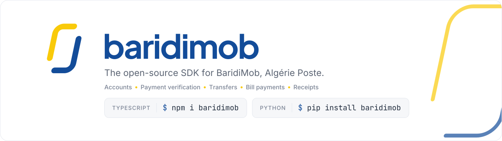

<div align="center">

<picture>
  <source media="(prefers-color-scheme: dark)" srcset="assets/banner-dark.svg">
  
</picture>

<br>

Read your BaridiMob accounts, verify incoming payments, send transfers and pay bills from your own code.

[](https://www.npmjs.com/package/baridimob)
[](https://pypi.org/project/baridimob/)
[](LICENSE)

</div>

---

## Packages

The SDK is available for two languages. Both expose the same features with the same names.

| Language | Install | Documentation |
|----------|---------|---------------|
| **TypeScript / JavaScript** | `npm install baridimob` | [typescript/README.md](typescript/README.md) |
| **Python** | `pip install baridimob` | [python/README.md](python/README.md) |

## What you can do

| Feature | Description |
|---------|-------------|
| **Login** | Sign in with your BaridiMob credentials. The device is confirmed once by SMS, then reused. |
| **Accounts** | List accounts, read the balance, browse the full transaction history. |
| **Payment verification** | Confirm that a customer's transfer has really arrived, by reference number and amount. |
| **Transfers** | Send money to another account (always confirmed by SMS code). |
| **Bill payments** | Mobile top-up (Mobilis, Djezzy, Ooredoo), Algérie Télécom and other billers. |
| **Receipts** | List recent operations and download their PDF receipts. |

## Quick look

**TypeScript**

```ts
import { createBaridiMob, fileStorage } from 'baridimob';

const bm = createBaridiMob({ storage: fileStorage('./session.json') });
await bm.auth.login({ login: 'your-login', password: 'your-password' });

const balance = await bm.accounts.balance();
```

**Python**

```python
from baridimob import Config, FileStorage, create_client

bm = create_client(Config(storage=FileStorage("./session.json")))
bm.auth.login("your-login", "your-password")

balance = bm.accounts.balance()
```

The first login on a new machine asks for an SMS code. See each package's documentation for the full flow.

## Repository layout

```
typescript/   npm package "baridimob"
python/       PyPI package "baridimob"
```

## Security

This library handles real banking credentials. Please read this carefully:

- **The saved session is a live credential.** Anyone who has the session file can access the account. Never commit it, share it, or log it. Encrypt it at rest in production.
- **HTTPS is enforced.** Plain HTTP is refused, except for `localhost` during development.
- **Moving money always requires an SMS code** that you pass explicitly. Read-only operations never do.

If you find a security issue, please report it privately instead of opening a public issue.

## Disclaimer

This is an independent community project. It is **not affiliated with, endorsed by, or supported by Algérie Poste**. BaridiMob may change its service at any time, which can break this SDK. Use it at your own risk and in accordance with Algérie Poste's terms of service.

## License

[MIT](LICENSE)
